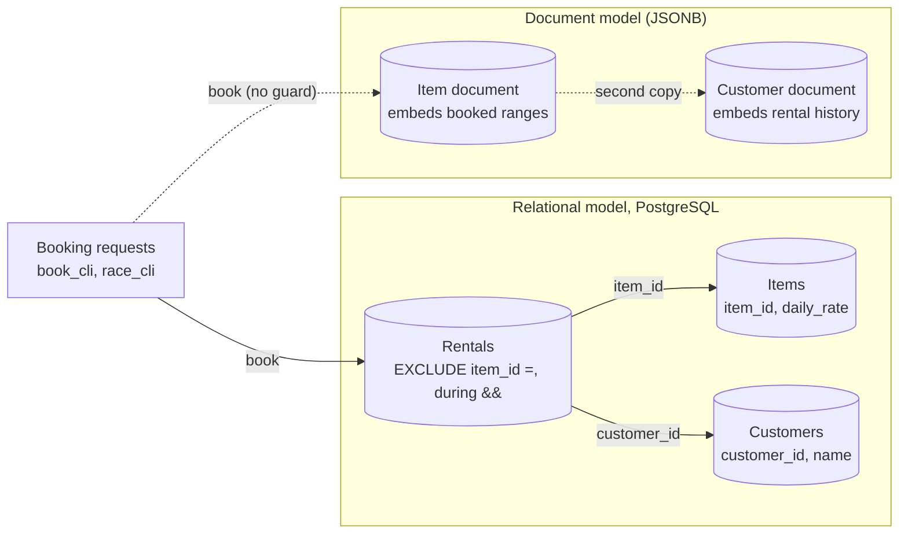

# Architecture: the rental shop's data layer

Component names match the lesson's diagram ("The rental shop, modeled two ways"): **Booking requests**, **Rentals**, **Items**, **Customers** in the relational model on PostgreSQL, and **Item document**, **Customer document** in the document model.

## Components and what each owns

| Component | Where it lives | What it owns |
| --- | --- | --- |
| **Rentals** (table) | [`sql/001_schema.sql`](sql/001_schema.sql), constraint in [`sql/migrations/001_exclusion_constraint.sql`](sql/migrations/001_exclusion_constraint.sql) | One row per rental: item, customer and a half-open `daterange`. Owns the rule that one item is never rented twice for overlapping dates (the exclusion constraint `rentals_item_id_during_excl`) and the check that refuses empty ranges. |
| **Items** (table) | [`sql/001_schema.sql`](sql/001_schema.sql) | Item id, name and daily rate (`numeric(8,2)`, must be positive). |
| **Customers** (table) | [`sql/001_schema.sql`](sql/001_schema.sql) | Customer id and name. |
| **Item document**, **Customer document** | [`sql/document_model/`](sql/document_model/), [`docs/DOCUMENT_MODEL.md`](docs/DOCUMENT_MODEL.md) | The same domain as JSONB documents with the booked ranges embedded. They exist to show what a document model cannot enforce. |
| **Booking request** (use case) | [`application/book_item.py`](src/rental_shop/application/book_item.py), program [`interfaces/book_cli.py`](src/rental_shop/interfaces/book_cli.py) | Builds the period, inserts, maps the database's refusal to `ItemAlreadyBookedError`, retries a deadlock victim. Contains no availability check. |
| **Shop questions** (use case) | [`application/shop_questions.py`](src/rental_shop/application/shop_questions.py), program [`interfaces/report_cli.py`](src/rental_shop/interfaces/report_cli.py) | The five questions of lesson step 1 as one report. |
| **Race** (use case) | [`application/race.py`](src/rental_shop/application/race.py), program [`interfaces/race_cli.py`](src/rental_shop/interfaces/race_cli.py) | Step 5: 20 connections, one barrier, one fresh item per round, the tally. |
| **Rental repository** (adapter) | [`infrastructure/postgres_rentals.py`](src/rental_shop/infrastructure/postgres_rentals.py) | All SQL the application runs, the two insert modes, and the translation of SQLSTATEs (`23P01`, `23503`, `40P01`) to named errors. |
| **Connection** (adapter) | [`infrastructure/postgres.py`](src/rental_shop/infrastructure/postgres.py) | Connect timeout, statement timeout, search path, retry with backoff; autocommit so `transaction()` is the only boundary. |

## Pattern: ports and adapters

The booking, report and race logic sits in `application` and knows nothing about PostgreSQL. It asks for a `RentalBooking`, a `RentalQueries` (together a `RentalGateway`), a `GatewayOpener` that hands each thread its own session, and a `Clock`. `infrastructure/postgres_rentals.py` implements the gateway with psycopg 3. The domain has the half-open `RentalPeriod` (with its own `overlaps`, so the application can reason about periods without a database), immutable entities and the named errors. The in-memory shop used by the unit tests refuses overlaps under a lock the way the constraint does, so the race orchestration, the retry and the report are tested without a database; the same behavior is then checked against the real constraint in the integration tests.

The pattern is deliberately small. The lesson's subject is a rule that lives in the database, so the application is thin on purpose: if it grew a rental-availability service, it would be duplicating the constraint. The dependency rule (domain depends on nothing; application on domain; infrastructure and interfaces on both; nothing on interfaces) is enforced by import-linter in `make lint`, and a second contract forbids `domain` and `application` from importing `psycopg`.

## Data flow

### One booking, step by step (`make book ITEM=1 CUSTOMER=2 FROM=2026-11-03 DAYS=2`)

1. `book_cli` reads and validates the environment (`Settings.from_env`), configures logging, and opens one connection with the connect timeout, the statement timeout and the search path.
2. `BookItem` builds `RentalPeriod.starting(2026-11-03, 2)`, which is `[2026-11-03, 2026-11-05)`. A length below one day is `InvalidPeriodError` here, before any statement.
3. `PostgresRentals.book` runs one statement in a transaction: `INSERT ... ON CONFLICT ON CONSTRAINT rentals_item_id_during_excl DO NOTHING RETURNING rental_id`.
4. PostgreSQL probes the constraint's GiST index for a rental of item 1 whose range overlaps `[11-03, 11-05)`. Rental 1 (`[11-01, 11-04)`) does, so nothing is inserted and no row returns.
5. The adapter turns "no row" into `ItemAlreadyBookedError`; the program prints `already booked: item 1 is already booked for dates overlapping 2026-11-03 to 2026-11-05` and exits 3. A booking for `2026-11-06` for two days finds no overlap, inserts, returns `rental_id` and exits 0.
6. In `--insert raise` mode step 3 is a plain `INSERT`, step 4 raises SQLSTATE `23P01`, and step 5 maps that exception instead.

### One race, step by step (`make race`)

1. A setup session creates a fresh item and a customer for the round, so rounds never see each other's rows.
2. Twenty threads each open their own connection (outside the timed part), then wait at a `threading.Barrier(20)`.
3. The barrier releases them together. Each books `[2027-01-04 + (i mod 3), +4 days)`; every pair of these periods overlaps.
4. The exclusion constraint serializes the decision: one insert is committed, the other nineteen are refused.
5. The tally is `1 success, 19 refused`. The program exits 0 only if every round had exactly one winner.

## Decisions and trade-offs

**The rule is a constraint, not code.** See [ADR 0001](docs/adr/0001-the-database-decides-the-booking.md). It holds for every writer, inside the transaction, and the index that enforces it also serves the availability question.

**`daterange`, half-open.** One column instead of two, an `&&` operator instead of `a.start < b.end AND b.start < a.end`, and the `[)` convention means a rental ending on the 4th and one starting on the 4th touch without clashing. PostgreSQL rewrites any closed input (`'[a,b]'`) to `[a,b+1)` for dates, so the bound checks in the table's `CHECK` state the rule but cannot fail; the check that does work is `NOT isempty`. A client that sends the return day as a closed bound (the "closed range" mistake) makes a touching rental clash; [`sql/004_constraint_demo.sql`](sql/004_constraint_demo.sql) shows it.

**Two insert modes.** The plain `INSERT` raises `23P01` but can deadlock under a burst of overlapping inserts; `ON CONFLICT DO NOTHING` cannot. See [ADR 0002](docs/adr/0002-two-insert-modes-for-booking.md). `deadlock_timeout` is 100 ms in the compose file so the plain mode's deadlocks resolve quickly; the default is one second.

**Identity columns with explicit seed ids.** `GENERATED BY DEFAULT AS IDENTITY` lets the seed use the lesson's ids (1 to 7) and lets new rows take the next number; each seed script moves the sequences past the explicit ids.

**Foreign keys do not index the child.** `rentals.customer_id` has its own composite index; `rentals.item_id` is covered by the leading column of the exclusion index.

**One schema per integration test.** The tests build the lesson's tables in a fresh schema (search path set per connection) and drop it afterwards, so they never touch the data a reader loaded with `make db`, and they run in any order.

**Operability.** Structured `logfmt` log lines on standard error, results on standard output; the database password is a required variable with no default and is excluded from the settings object's printed form. Connections have a connect timeout, a statement timeout and retry with exponential backoff and jitter. `SIGINT` and `SIGTERM` stop the race between rounds. `make health` is the health command; the image's `HEALTHCHECK` runs it.

## Failure modes the lesson teaches, and how to reproduce each

| Failure | What you see | Reproduce |
| --- | --- | --- |
| **Overlapping booking** | `ERROR: conflicting key value violates exclusion constraint "rentals_item_id_during_excl"`, SQLSTATE `23P01` | `make demo` |
| **Touching ranges** | `INSERT 0 1`: a rental may start on the day another ends | `make demo` |
| **Closed range** | `[2026-11-01,2026-11-04]` is stored as `[2026-11-01,2026-11-05)` and a touching rental then clashes | `make demo` |
| **Missing `btree_gist`** | `ALTER TABLE ... EXCLUDE` fails with "data type integer has no default operator class for access method gist" | run the `ALTER TABLE` of the migration without its first line |
| **Check, then insert** | Two requests both read "free" and both insert | not reproducible here by design: `BookItem` has no check. The document model's double booking is the shape of it (`make demo-documents`) |
| **Racing connections** | Exactly one winner in each of 20 runs | `make race`, and `make race-plain` for the deadlock behavior |
| **Two copies in documents** | The same drill booked twice, history and availability disagreeing | `make demo-documents` |
| **Stale statistics** | Plans chosen from the seed's seven rows | `make bulk` then compare `EXPLAIN` before and after `ANALYZE` |

## Limits of the teaching build against production

- **Cancellation is not modeled.** A canceled rental must leave the table (or be excluded with a `WHERE` predicate on the constraint) or it blocks the dates; the lesson's stretch goals cover it.
- **No pooling.** Each use case opens its own connection. A web service would use a pool and keep the statement timeout.
- **One node.** No replica, no failover; the constraint is enforced on the primary only.
- **No authorization.** Any session can book for any customer. Row-level security is a stretch goal.
- **Time zones.** Dates are local calendar days; a shop across zones would store the zone with the shop.
- **A throwaway password and plain-text connections** for a database that lives on the developer's machine.

## How to extend it

- **Soft delete:** add `canceled_at timestamptz` and rebuild the constraint with `WHERE (canceled_at IS NULL)`, so canceled rentals no longer block the dates.
- **Row-level security:** `ALTER TABLE rentals ENABLE ROW LEVEL SECURITY` with a policy on `customer_id = current_setting('shop.customer_id')::int`, and set that per session.
- **A real document store:** implement the same `RentalGateway` over MongoDB or similar and compare the code for the availability check; the unit tests' in-memory shop is the specification of what must hold.
